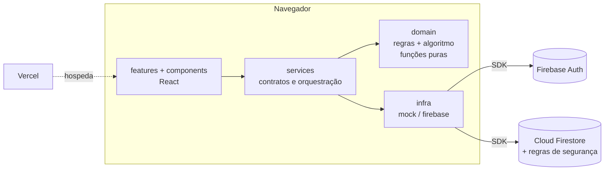

# Arquitetura

## Visão geral

Aplicação **SPA** (Vite + React + TypeScript) hospedada na **Vercel**, usando **Firebase Authentication** e **Cloud Firestore** como back-end gerenciado. Não há servidor próprio: o navegador fala direto com o Firebase, e as **regras do Firestore** garantem que cada usuário só acesse os próprios dados.



## Camadas

| Camada | Pasta | Pode importar | Não pode importar |
|---|---|---|---|
| Domínio | `src/domain` | nada externo | React, Firebase, services, infra |
| Serviços | `src/services` | domain | React, Firebase direto |
| Infraestrutura | `src/infra` | domain, services (contratos), Firebase | features, components |
| Interface | `src/features`, `src/components`, `src/app` | domain (tipos), services | infra, Firebase direto |

Regra principal: **a interface só conhece os contratos** de `src/services/contracts`. Na etapa 2 eles são atendidos por `infra/mock` (dados em memória); na etapa 3 por `infra/firebase`. A troca é feita em um único lugar (`createServices`, via `VITE_DATA_SOURCE`).

## Módulos (exigência: 3 módulos funcionais)

| Módulo | Pasta | Requisitos |
|---|---|---|
| Contas e perfil | `features/auth`, `features/profile` | RF01, RF11, RF12, RF13 |
| Rotina e tarefas | `features/routine`, `features/tasks` | RF02, RF03 |
| Planejamento | `features/planning`, `domain/planner` | RF04–RF10 |

## Estrutura de pastas

```
src/
  app/            roteador, rotas, providers
  components/     ui/ (kit base) e layout/ (menus)
  domain/         tipos, regras, validações, algoritmo (planner/)
  services/       contratos, orquestração (recalcular plano), fábrica
  infra/          mock/ (etapa 2) e firebase/ (etapa 3)
  features/       auth, routine, tasks, planning, profile
  hooks/, utils/, styles/
tests/            unit, integration, e2e, non-functional, features
docs/             arquitetura, requisitos, relatorio, design, testes, ia
```

## Modo demonstração

Sem login, a interface usa `createDemoServices()` (dados de exemplo só em memória) e fica somente leitura: qualquer ação abre o modal de cadastro. Depois do login, `PlannerProvider` troca para os serviços do usuário. Isso fica em `src/app/providers/PlannerProvider.tsx`.

## Fluxo de recálculo (RF09)

1. O usuário altera algo (tarefa, rotina, bloco, configuração).
2. `services/planningService.recalculatePlan` lê os dados pelos repositórios.
3. Chama `domain/planner/generatePlan(input)` — **função pura** que recebe `now` como parâmetro.
4. Salva os blocos novos (fixados e concluídos são preservados) e devolve os alertas.

Mais detalhes: [modelo-de-dados.md](modelo-de-dados.md) e [decisões (ADRs)](adr/).
